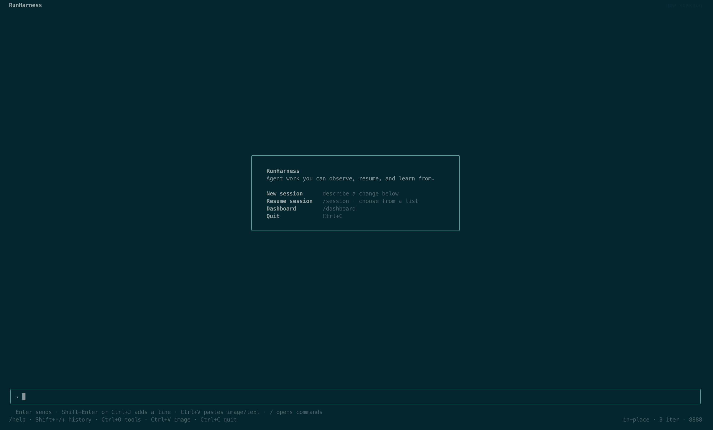
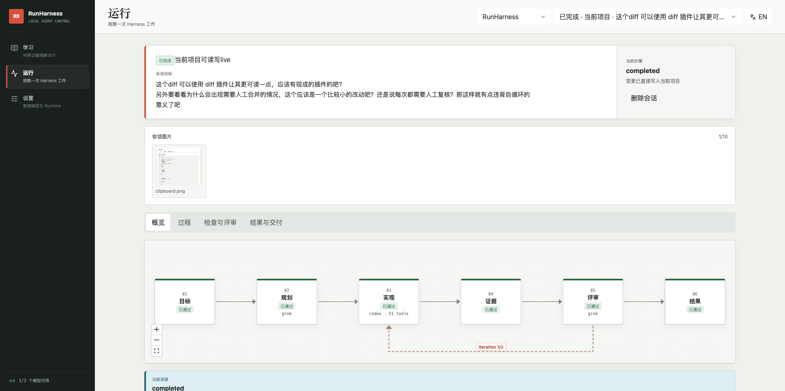

# RunHarness

[中文](README.md)

RunHarness is an experimental project for learning how Agent Harnesses work.

I first read three Anthropic articles about Auto Mode, Managed Agents, and harness design for long-running work, then wrote an article with my own practical thoughts. After finishing it, I still felt that I did not truly understand what a harness should own or how it should coordinate agents, tools, context, review, and safety boundaries.

That led me to build a real, observable, and extensible learning project based on those four articles. RunHarness is not a mature product or a fully validated general-purpose harness. Its code and interactions are still rough. If it helps someone understand harnesses more directly or gives them a useful starting point for further experiments, it has served its original purpose.

## The four starting articles

- [AI 会写代码之后，真正稀缺的是判断力](https://x.com/yellin__/article/2075509835450249474)
- [How we built Claude Code auto mode: a safer way to skip permissions](https://www.anthropic.com/engineering/claude-code-auto-mode)
- [Scaling Managed Agents: Decoupling the brain from the hands](https://www.anthropic.com/engineering/managed-agents)
- [Harness design for long-running application development](https://www.anthropic.com/engineering/harness-design-long-running-apps)

These articles are the project's starting point, not a permanent boundary for future work. Agent harness technology is still evolving quickly. RunHarness may absorb new public research, protocols, and practices when they make the core flow easier to understand, observe, and learn from. New concepts may also replace today's idea of a harness entirely; if that happens, this project will have completed its mission.

## How it works today

Run `runharness` inside a target project. The TUI connects to a local Runtime dedicated to that project. The TUI is the primary workspace, while the Web Dashboard observes the same Sessions, Runs, Agents, tools, checks, and reviews.

```text
TUI ───────────────┐
                   ├─ Project Runtime ─ Session / Events / Agents / Review
Web Dashboard ─────┘                         │
                                     local project data
```

Each user submission creates a Run. The Planner proposes a plan, the Generator works in the selected workspace, and the Evaluator independently reviews the result. When review requests changes, the Runtime carries the evidence into the next iteration. Every Run must eventually become `completed`, `failed`, or `stopped`; plan and permission gates remain explicit resumable states.

RunHarness currently provides:

- CLI Agent and API Agent routing;
- live text, tool-call, and original failure events;
- Session recovery, Continue, Steer, and multi-iteration loops;
- in-place workspaces and isolated workspaces with inspect/apply/discard delivery;
- project checks, MCP tools, review control signals, and permission confirmation;
- a primary TUI and a bilingual Web Dashboard;
- project-scoped JSON/JSONL state, attachments, results, and recovery context.

For a concise map of the code, see [ARCHITECTURE.en.md](ARCHITECTURE.en.md).

## Interface preview

### Active TUI Session



### Session overview and iteration flow



## Installation

RunHarness requires Node.js 20 or newer. It does not bundle a model. You need an authenticated local CLI Agent or an API Agent configured in the Dashboard.

### npm

```bash
npm install --global runharness
cd your-project
runharness
```

### pnpm

```bash
pnpm add --global runharness
cd your-project
runharness
```

### From source

```bash
git clone https://github.com/yellinzero/RunHarness.git
cd RunHarness
corepack enable
pnpm install
pnpm build
pnpm runharness
```

## Common commands

```bash
runharness                         # Open the TUI
runharness --web                   # Open the TUI and launch the Dashboard
runharness --web --port 8888       # Select the local Runtime port
runharness -p "Fix the failing test" # Run once without the interactive TUI
runharness agents                  # Show Agent routing and capabilities
runharness data                    # Show storage used by the current project
runharness clean                   # Delete RunHarness data for the current project
```

Use `/help` in the TUI for the complete command list. Project data is stored in `~/.runharness/projects/<project-hash>` by default, while live Runtime discovery records are stored in `~/.runharness/runtimes`. Set `RUNHARNESS_HOME` to change the data root.

## Development and testing

```bash
pnpm install
pnpm runharness       # Start the TUI and Runtime from source
pnpm dev              # Develop the Dashboard and API
pnpm lint
pnpm typecheck
pnpm test
pnpm build
pnpm package:check
```

Changes to asynchronous lifecycle code should verify immediate API return, event flow, explicit terminal states, and stop behavior. TUI changes should be checked in a real terminal for input, wrapping, images, recovery, and exit behavior. Dashboard changes should be checked at desktop and narrow widths.

When RunHarness develops itself, use the two-phase dogfood flow so the active Runtime never replaces its own executable during a Run:

```bash
pnpm dogfood:prepare
# After the current Run finishes and the old TUI exits
pnpm dogfood:activate
```

## Current limitations

- This is a learning project and should not be used directly for high-risk production automation.
- Provider-native tools and RunHarness-managed tools do not always expose the same permission callbacks.
- Local command execution is not container or VM isolation; untrusted code needs a stronger external boundary.
- API Agents can act only through configured MCP tools. Without file or command tools, they cannot directly modify a repository.

## License

MIT
