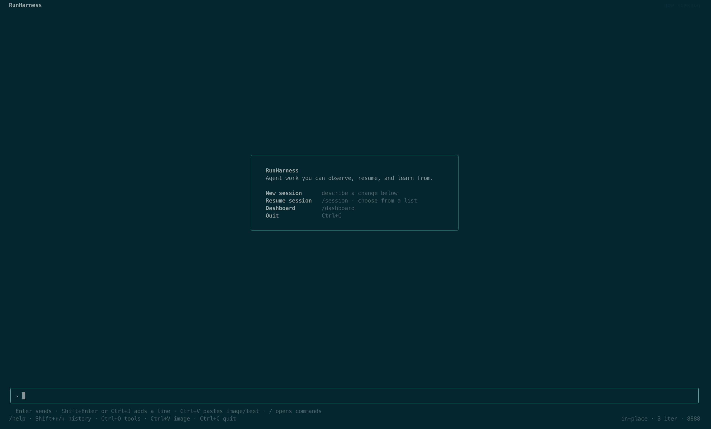
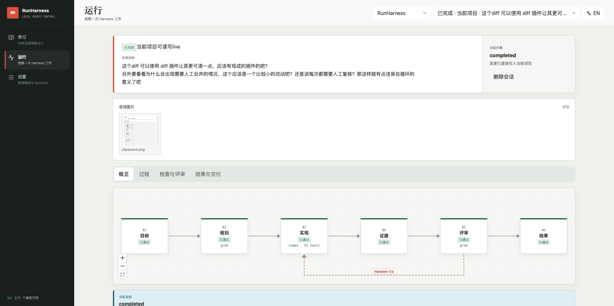

# RunHarness

[English](README.en.md)

RunHarness 是一个用来学习 Agent Harness 的实验性项目。

我最初阅读了 Anthropic 关于 Auto Mode、Managed Agents 和长任务 Harness 设计的三篇文章，随后写下了一篇自己的实践思考。文章写完以后，我仍然觉得自己没有真正理解：Harness 究竟负责什么，它和 Agent、工具、上下文、评审、安全边界之间应该怎样协作？

所以我决定参考这四篇文章，亲手实现一套能够真实运行、可以观察、也方便继续扩展的学习项目。它并不是成熟产品，也不是一套已经被充分验证的通用 Harness；代码和交互仍然粗糙。如果它能帮助其他人更直观地理解 Harness，或者成为继续实验的起点，就已经达到了这个项目最初的目的。

## 四篇起点文章

- [AI 会写代码之后，真正稀缺的是判断力](https://x.com/yellin__/article/2075509835450249474)
- [How we built Claude Code auto mode: a safer way to skip permissions](https://www.anthropic.com/engineering/claude-code-auto-mode)
- [Scaling Managed Agents: Decoupling the brain from the hands](https://www.anthropic.com/engineering/managed-agents)
- [Harness design for long-running application development](https://www.anthropic.com/engineering/harness-design-long-running-apps)

这些文章是项目的出发点，不是未来功能的边界。Harness 技术仍在快速发展，后续也许会继续吸收新的公开研究、协议和实践，只要它们能让核心流程更清楚、更可观察，也更适合学习，当然也有可能马上有新的概念来替代harness，那么这个项目应该也就完成了它的使命。

## 它现在怎样工作

在目标项目目录运行 `runharness` 后，TUI 会连接一个仅服务当前项目的本地 Runtime。TUI 是主要工作界面；Web Dashboard 观察同一个 Session、Run、Agent、工具、检查和评审过程。

```text
TUI ───────────────┐
                   ├─ Project Runtime ─ Session / Events / Agents / Review
Web Dashboard ─────┘                         │
                                     local project data
```

一次输入创建一个 Run。Planner 形成计划，Generator 在项目工作区执行，Evaluator 独立检查结果；如果评审要求修改，Runtime 会把证据带入下一轮。Run 最终必须进入 `completed`、`failed` 或 `stopped`，等待计划或权限确认则保留为可继续的状态。

RunHarness 目前提供：

- CLI Agent 与 API Agent 路由；
- 实时文字、工具调用和失败原因事件；
- Session 恢复、Continue、Steer 和多轮自循环；
- in-place 工作区与可 inspect/apply/discard 的 isolated 工作区；
- 项目检查、MCP 工具、评审控制信号和权限确认；
- TUI 主界面与双语 Web Dashboard；
- 项目级 JSON/JSONL 状态、附件、结果和恢复上下文。

更具体但仍保持简短的代码边界见 [ARCHITECTURE.md](ARCHITECTURE.md)。

## 界面预览

### 运行中的 TUI Session



### Session 总览与迭代流程



## 安装

要求 Node.js 20 或更新版本。RunHarness 不包含模型，需要本机已有可用的 CLI Agent，或在 Dashboard 中配置 API Agent。

### npm

```bash
npm install --global runharness
cd your-project
runharness
```

### pnpm

```bash
pnpm add --global runharness
cd your-project
runharness
```

### 从源码运行

```bash
git clone https://github.com/yellinzero/RunHarness.git
cd RunHarness
corepack enable
pnpm install
pnpm build
pnpm runharness
```

## 常用操作

```bash
runharness                         # 打开 TUI
runharness --web                   # 打开 TUI，并自动打开 Dashboard
runharness --web --port 8888       # 指定本地 Runtime 端口
runharness -p "修复当前测试失败"   # 非交互运行一次
runharness agents                  # 查看当前 Agent 路由与能力
runharness data                    # 查看当前项目数据占用
runharness clean                   # 删除当前项目的 RunHarness 数据
```

TUI 中可使用 `/help` 查看完整命令。默认数据位于 `~/.runharness/projects/<project-hash>`；在线 Runtime 发现信息位于 `~/.runharness/runtimes`。设置 `RUNHARNESS_HOME` 可以修改数据根目录。

## 开发与测试

```bash
pnpm install
pnpm runharness       # 从源码启动 TUI 与 Runtime
pnpm dev              # 开发 Dashboard 与 API
pnpm lint
pnpm typecheck
pnpm test
pnpm build
pnpm package:check
```

涉及异步生命周期时，应同时验证立即返回、事件流、明确终态和停止行为。TUI 变更需要在真实终端检查输入、换行、图片、恢复和退出；Dashboard 变更需要检查桌面与窄屏布局。

RunHarness 修改自身时使用两阶段 dogfood 流程，避免活动 Runtime 在自己的 Run 中替换自己：

```bash
pnpm dogfood:prepare
# 当前 Run 结束并退出旧 TUI 后
pnpm dogfood:activate
```

## 当前限制

- 这是学习项目，不建议直接承担高风险生产自动化。
- Provider 原生工具与 RunHarness 管理的工具并不总有相同的权限回调能力。
- 本地命令运行不是容器或虚拟机隔离；不可信代码需要更强的外部边界。
- API Agent 的行动能力来自项目配置的 MCP 工具；没有文件或命令工具时，它不能直接修改代码。

## License

MIT
